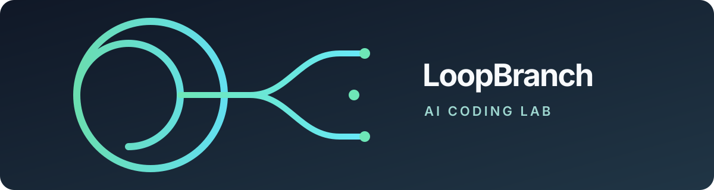

  

  <h1>LoopBranch Lab</h1>

  
<strong>AI Coding 创造实验室</strong>

  
Explore ideas. Build with AI. Keep branching.

---

LoopBranch Lab 是一个围绕 **AI Coding** 展开创作与实验的空间。我们把想法做成原型，在实际开发中检验，再将有价值的过程与方法整理出来。

### 探索方向

- **AI 辅助开发**：探索人与 AI 协作编写软件的方式。
- **工具与原型**：用小而清晰的实验验证创意。
- **经验沉淀**：分享实践中的方法、发现与改进。

### 项目

项目公开后，可以在 [Repositories](https://github.com/orgs/loopbranch/repositories) 查看代码与文档。

<!-- 发布项目后，在这里补充 2–3 个精选项目及其入口。 -->
